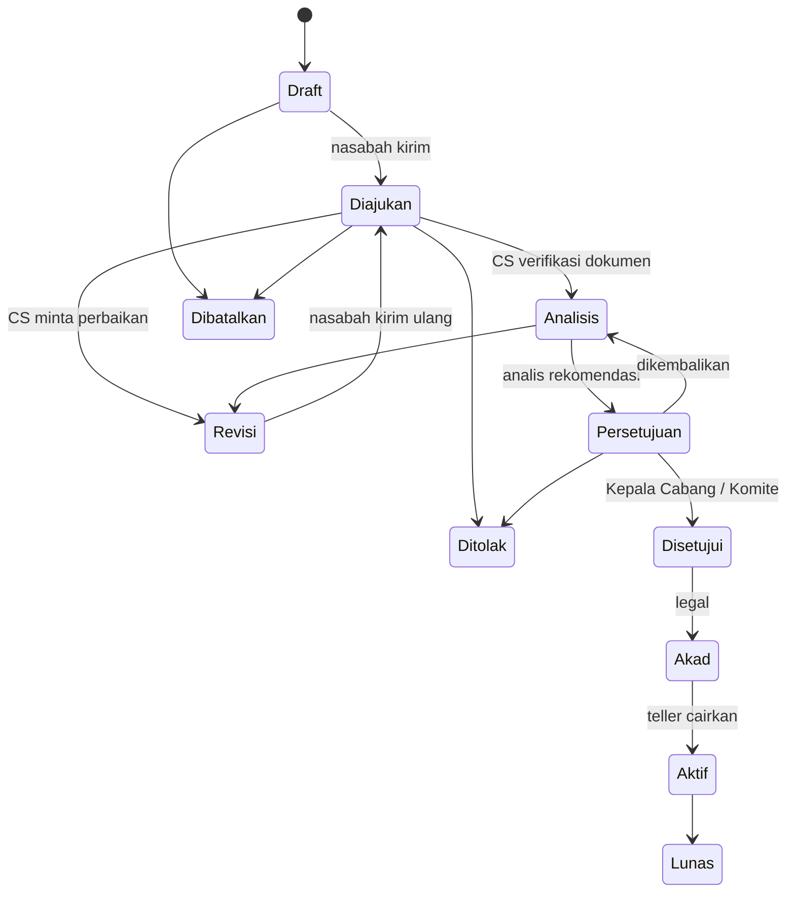
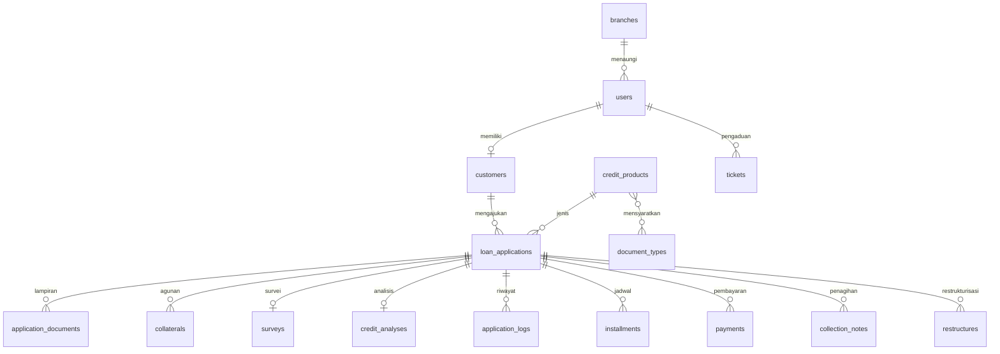

# SiKredit — Sistem Informasi Pelayanan Pengajuan Kredit Bank

Aplikasi web untuk melayani pengajuan kredit dari nasabah secara online hingga kredit lunas:
registrasi, pengajuan & unggah dokumen, verifikasi, analisis 5C & credit scoring, survei,
persetujuan berjenjang, akad, pencairan, angsuran, collection, serta laporan manajemen.

**Teknologi:** Laravel 12 (PHP 8.2+), Blade + Tailwind CSS + Alpine.js, Chart.js, DomPDF,
SQLite/MySQL/PostgreSQL.

---

## Cara Cepat (Windows, untuk pemula)

1. Pasang **Laravel Herd** (https://herd.laravel.com/windows), yang sudah termasuk PHP & Composer, dan **Node.js LTS** (https://nodejs.org).
2. Klik dua kali **`setup.bat`** di folder `sikredit` (cukup sekali, butuh beberapa menit).
3. Klik dua kali **`jalankan.bat`**. Browser akan membuka http://127.0.0.1:8000 secara otomatis.

## Instalasi

```bash
cd sikredit
composer install
npm install && npm run build
cp .env.example .env
php artisan key:generate
touch database/database.sqlite        # atau atur DB_* untuk MySQL/PostgreSQL di .env
php artisan migrate --seed            # struktur + data demo
php artisan serve                     # http://127.0.0.1:8000
```

Tugas terjadwal (denda, kolektibilitas, pengingat jatuh tempo) membutuhkan cron:

```
* * * * * cd /path/ke/sikredit && php artisan schedule:run >> /dev/null 2>&1
```

| Perintah | Fungsi | Jadwal |
|---|---|---|
| `php artisan kredit:refresh` | Hitung ulang denda, hari tunggakan, kolektibilitas, outstanding | 00:30 setiap hari |
| `php artisan kredit:reminders` | Kirim pengingat H-3, H-0, dan pemberitahuan H+1 | 08:00 setiap hari |

Menjalankan test: `php artisan test` (41 test: unit perhitungan, workflow end-to-end, otorisasi, dan smoke test seluruh halaman).

## Akun Demo

Semua akun memakai kata sandi **`password123`**.

| Peran | Email | Keterangan |
|---|---|---|
| Super Admin | `admin@sikredit.test` | Master data, pengguna, pengaturan, audit trail |
| Komite Kredit | `komite@sikredit.test` | Memutus plafon > Rp500 juta, semua cabang |
| Customer Service | `cs.jkt@sikredit.test` | Verifikasi dokumen, pengaduan |
| Analis Kredit | `analis.jkt@sikredit.test` | Survei, appraisal, analisis 5C & scoring |
| Kepala Cabang | `kacab.jkt@sikredit.test` | Memutus plafon ≤ Rp500 juta, restrukturisasi |
| Admin Legal | `legal.jkt@sikredit.test` | Perjanjian kredit, pengikatan agunan, akad |
| Teller | `teller.jkt@sikredit.test` | Pencairan, pembayaran angsuran, pelunasan |
| Collection | `collection.jkt@sikredit.test` | Pemantauan tunggakan & catatan penagihan |
| Nasabah | `budi1@contoh.test`, `siti2@contoh.test`, … | 15 nasabah dengan berbagai kondisi kredit |

Petugas tersedia untuk 4 cabang: ganti `jkt` dengan `bdg`, `sby`, atau `yog`. Data demo memuat 20 pengajuan
di semua status, termasuk kredit lancar, DPK, kurang lancar, macet, dan lunas.

## Fitur

**Portal publik**: profil produk (KPR, KKB, KMK, KI, KTA, KUR, Multiguna), simulasi kredit flat/efektif/anuitas
beserta tabel angsuran, cek kelayakan (pre-screening), FAQ, lokasi cabang, serta syarat & ketentuan.

**Nasabah**: registrasi, profil lengkap (data pribadi, pekerjaan, keuangan, pasangan, kontak darurat), wizard
pengajuan 4 langkah dengan estimasi angsuran & DSR real-time, unggah dokumen per jenis, timeline status,
jadwal angsuran, riwayat pembayaran & kuitansi, simulasi pelunasan dipercepat, unduh SP3K/perjanjian, pengaduan,
dan notifikasi.

**Workflow & SLA**



- Setiap perpindahan status melalui `App\Services\ApplicationWorkflow`. Perubahan dicatat beserta pelaku, waktu,
  dan catatan, lalu memicu notifikasi ke nasabah dan petugas tahap berikutnya.
- SLA per tahap dihitung dalam hari kerja, dengan akhir pekan & hari libur dikecualikan; keterlambatan ditandai.
- Persetujuan berjenjang: plafon sampai batas wewenang diputus Kepala Cabang, di atasnya oleh Komite.
- Pemisahan tugas: pemutus tidak boleh petugas yang memproses (CS/analis) pengajuan yang sama.

**Analis kredit**: form 5C dengan skor sementara live, credit scoring berbobot (bisa diatur), penyesuaian SLIK/DSR/LTV,
grade A–E, survei lapangan dengan geotag & foto, appraisal agunan, serta memo analisis (PDF).

**Pinjaman & collection**: jadwal angsuran otomatis (tanggal jatuh tempo digeser dari hari libur), alokasi
pembayaran denda → bunga → pokok, denda harian, kolektibilitas OJK 1–5 berdasarkan hari tunggakan, pelunasan
dipercepat, restrukturisasi (rescheduling/reconditioning), catatan penagihan & janji bayar.

**Dashboard & laporan**: KPI per peran (antrian, approval rate, SLA, outstanding, NPL), grafik tren & portofolio,
7 laporan (pengajuan, keputusan, pencairan, outstanding, tunggakan, penerimaan, kinerja petugas) dengan filter
periode/produk/cabang, ekspor CSV (dibuka di Excel), dan cetak/PDF.

**Administrasi**: CRUD produk (termasuk dokumen wajib per produk), cabang, jenis dokumen, hari libur,
pengguna & peran, parameter sistem (bobot scoring, DSR, batas wewenang, SLA, 2FA), template notifikasi, audit trail.

## Keamanan

- Kata sandi di-hash (bcrypt), aturan kata sandi kuat, rate limit login (5×/menit), sesi berakhir 30 menit.
- Verifikasi dua langkah (OTP email) untuk petugas, dapat diaktifkan di Pengaturan.
- NIK, No. KK, NPWP, dan nomor rekening pencairan dienkripsi di database; duplikasi NIK dicek lewat HMAC.
- Dokumen & foto survei disimpan di penyimpanan privat dan hanya disajikan setelah otorisasi.
- Akses berbasis peran (middleware `role`) dan cakupan cabang (Gate `view-application`).
- Proteksi CSRF/XSS bawaan Laravel, validasi server-side di semua form, security headers.
- Audit trail untuk login, perubahan data, akses dokumen, keputusan kredit, dan ekspor laporan.

## Struktur Kode

```
app/Enums            Role, ApplicationStatus, Collectibility, InterestMethod
app/Services         LoanCalculator, CreditScoringService, ApplicationWorkflow, LoanService, BusinessCalendar
app/Http/Controllers Public, Auth, Customer/*, Admin/* (Process = aksi workflow per peran), Print
app/Console/Commands kredit:refresh, kredit:reminders
resources/views      public, auth, customer, admin, print (PDF), components
database/seeders     MasterData, User, LoanApplication (data demo melalui workflow sungguhan)
tests                Unit (perhitungan) & Feature (alur end-to-end, otorisasi, halaman)
```



## Deployment (produksi)

1. Set `APP_ENV=production`, `APP_DEBUG=false`, `APP_URL=https://…`, dan gunakan MySQL/PostgreSQL.
2. Isi konfigurasi `MAIL_*` agar notifikasi & OTP terkirim. Default `MAIL_MAILER=log` hanya menulis ke log.
3. `composer install --no-dev --optimize-autoloader && npm ci && npm run build`
4. `php artisan migrate --force` lalu `php artisan db:seed --class=MasterDataSeeder` (tanpa data demo), kemudian
   buat akun admin melalui `php artisan tinker`.
5. `php artisan config:cache route:cache view:cache`, pasang cron scheduler, aktifkan HTTPS, dan aktifkan
   2FA petugas di Pengaturan.
6. Cadangkan `APP_KEY`. Data terenkripsi tidak dapat dibaca tanpa key yang sama.
